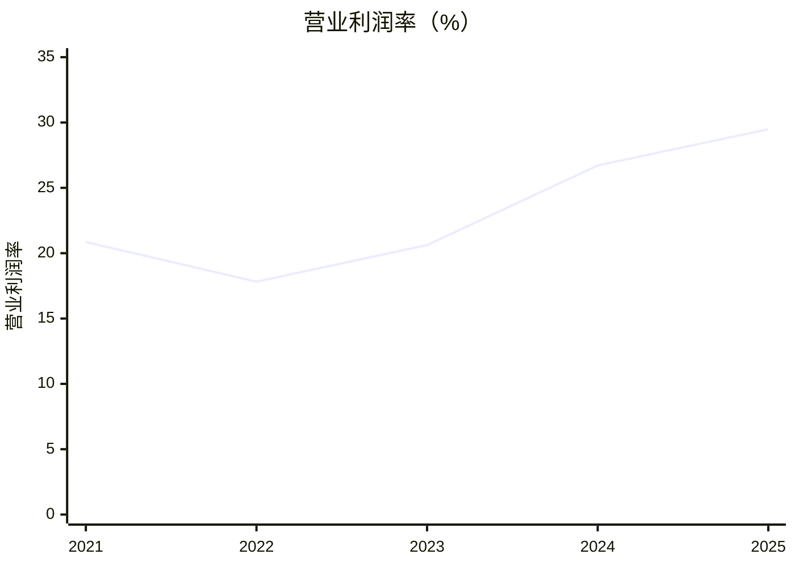

# Netflix（NFLX）研究报告

> 研究日期：2026-10-20，纽约时间，已纳入当晚公布的第三季度业绩。  
> 股价：正常收盘68.69美元；盘后19时59分64.72美元。供应商收盘市值快照约2,860亿美元。  
> 常态2026年EPS研究估计3.05美元，对应收盘22.52倍、盘后21.22倍。  
> 核心判断：全球内容分发与订阅能力仍强，价格下降改善投资条件；广告执行受挫，使长期增长不能照搬过去的预期。

行情参考[StockAnalysis](https://stockanalysis.com/stocks/nflx/statistics/)，收盘另与[ChartExchange](https://chartexchange.com/symbol/nasdaq-nflx/historical/)核对。后者收盘68.67美元，差异低于1%；盘后由[CoinGlass](https://www.coinglass.com/stocks/NFLX)核对。盘后报价是历史快照，实际下单须重新看价。所有每股数字采用十拆一后口径。

## AI研究偏见自觉

信息丰富度评级：A级。Netflix资料充分、市场覆盖密集，最容易犯的错误是把“全球流媒体赢家”自动换成“任何价格都值得长期持有”。

- [x] 把公司经营质量与当前价格的回报前景分别判断。
- [x] 同时检查广告指引下修与订阅留存改善，避免只解释股价下跌。
- [x] 剔除WBD一次性终止费，检查巴西税低基数及费用时点。
- [x] 不把模型复算通过当成增长预测已获证明。

AI研究局限：无法取得内部流失率、广告填充率和逐部作品回报；尚未核得Q3正式10-Q及独立确认的九月底期末流通股数。最新依据是公司股东信所附未审计财务表。管理层关于留存的定性披露无法由公开用户数据独立复核。

---

## 第一步：核心数据总览

### 五年经营记录

金额单位为十亿美元。FCF为经营现金流减物业设备资本开支，已扣内容现金支付。

| 财年 | 收入 | 净利润 | 毛利率 | 营业利润率 | FCF | 现金及短投 |
|---|---:|---:|---:|---:|---:|---:|
| 2021年 | 29.698 | 5.116 | 41.64% | 20.86% | -0.132 | 6.028 |
| 2022年 | 31.616 | 4.492 | 39.37% | 17.82% | 1.619 | 6.058 |
| 2023年 | 33.723 | 5.408 | 41.54% | 20.62% | 6.926 | 7.138 |
| 2024年 | 39.001 | 8.712 | 46.06% | 26.71% | 6.922 | 9.584 |
| 2025年 | 45.183 | 10.981 | 48.49% | 29.49% | 9.461 | 9.062 |

历史数据沿用已核验的[2025年10-K](https://www.sec.gov/Archives/edgar/data/1065280/000106528026000034/nflx-20251231.htm)、[2022年年报](https://s22.q4cdn.com/959853165/files/doc_financials/2022/ar/4e32b45c-a99e-4c7d-b988-4eef8377500c.pdf)，本次再与[StockAnalysis财务](https://stockanalysis.com/stocks/nflx/financials/)、[现金流](https://stockanalysis.com/stocks/nflx/financials/cash-flow-statement/)及[资产负债表](https://stockanalysis.com/stocks/nflx/financials/balance-sheet/)核对。Macrotrends本次访问返回403，未声称完成该来源核验。

利润率改善说明收入规模已经能覆盖更多内容和组织成本。但2023年现金流也受罢工影响的制作支付时点帮助，不能把每年变化都解读为永久效率。

### 最近四季与地区

金额单位十亿美元，EPS为美元；Q1净利含一次性交易收益。

| 指标 | 2025Q4 | 2026Q1 | 2026Q2 | 2026Q3 |
|---|---:|---:|---:|---:|
| 收入 | 12.051 | 12.250 | 12.560 | 12.874 |
| 营业利润 | 2.957 | 3.957 | 4.193 | 4.459 |
| 净利润 | 2.419 | 5.283 | 3.401 | 3.664 |
| 摊薄EPS | 0.56 | 1.23 | 0.80 | 0.87 |
| FCF | 1.872 | 5.094 | 1.525 | 2.884 |

| 地区收入 | 2025全年 | 2025Q4 | 2026Q1 | 2026Q2 | 2026Q3 |
|---|---:|---:|---:|---:|---:|
| 美加UCAN | 19.957 | 5.339 | 5.245 | 5.432 | 5.628 |
| 欧洲中东非洲EMEA | 14.515 | 3.873 | 3.998 | 4.034 | 4.107 |
| 拉美LATAM | 5.358 | 1.418 | 1.497 | 1.584 | 1.603 |
| 亚太APAC | 5.354 | 1.421 | 1.509 | 1.510 | 1.537 |

来源：[公司Q3财务附表](https://www.sec.gov/Archives/edgar/data/1065280/000106528026000290/ex991_q326.htm)、[独立季度序列](https://stockanalysis.com/stocks/nflx/financials/?p=quarterly)。四地区不是四个独立利润分部；公司未提供可比地区毛利率。季度合计可能受四舍五入影响。

Q3收入同比增长11.8%，营业利润率34.6%。全年收入预期511亿美元，营业利润率仍为31.5%；广告目标从30亿降至27亿美元，FCF目标从125亿降至120亿美元。前者主要因广告功能推出慢，后者主要因预计Q4房地产交易。[Q3股东信](https://www.sec.gov/Archives/edgar/data/1065280/000106528026000290/ex991_q326.htm)

九月底现金加短投82.230亿美元、账面有息债151.324亿美元，直接相减净债69.094亿美元；公司加回发行折价和套保调整后的净债为71.139亿美元。没有将内容负债或未入表内容承诺全部当金融债务再扣一次，因为内容现金支出已进入FCF。[公司净债调节表](https://www.sec.gov/Archives/edgar/data/1065280/000106528026000290/ex991_q326.htm)、[第三方资产表](https://stockanalysis.com/stocks/nflx/financials/balance-sheet/)

> 段永平式追问：利润率上升，究竟来自持续的用户价值，还是比较基数与付款时点？

---

## 第二步：生意本质分析

**Netflix为全球家庭持续提供值得付费的内容组合，用月费回收内容投入，再把部分观看机会卖给广告主。**

| 环节 | 经济机制 | 真正要盯的指标 |
|---|---|---|
| 订阅 | 付费家庭、价格和套餐组合共同决定收入 | 提价后的新增与流失 |
| 广告 | 观看、广告量、填充率和单价共同决定收入 | 扣除低价套餐损失与广告成本后的增量收益 |
| 内容 | 成本先发生，同一作品可跨地区重复分发 | 每单位现金投入的长期留存与获客 |
| 产品 | 推荐、搜索和传输降低找片、播放摩擦 | 是否让用户更愿意续费 |
| 利润 | 收入快于内容及组织成本时释放经营杠杆 | 现金与利润能否一起改善 |

这门生意优于单一制片厂的地方，在于每月出售整个内容组合，单部作品失败不会立即摧毁全部收入。其短板是取消订阅容易，用户可以暂停、轮换，等下一部热门剧再来。

现金资本需求主要藏在经营现金流的内容制作和采购中。只看物业设备资本开支，就会把它误判为几乎不需要再投资的软件企业。内容会过时，维持价值必须继续投入。

广告也不是额外赠送的利润：低价套餐会改变订阅收入结构，广告销售、测量和技术平台都要花钱。公司10月20日公布Pixel、转化API和定向更新，说明能力仍在建设；产品推出能否转化为更高广告回报尚待验证。[广告产品公告](https://about.netflix.com/en/news/netflix-ads-suite-has-better-buying-better-planning-better-results)

技术壁垒来自推荐、传输和经营数据的共同积累。它们有用，但没有充分证据量化为“领先竞争对手多少年”。技术发展费用包含产品工程，不能全部称为AI研发。全球内容生产可以运用AI降本，但其他平台与制作方也能使用同类工具。

> 段永平式追问：没有一部现象级新剧的月份，用户还会觉得整套服务值得保留吗？

---

## 第三步：护城河评估

| 来源 | 判断 | 证伪方式 |
|---|---|---|
| 全球规模 | 强；同一作品跨市场摊薄成本 | 内容支出长期快于收入且留存未改善 |
| 品牌与定价权 | 中强；较容易成为默认娱乐订阅 | 提价引发持续流失和促销依赖 |
| 转换成本 | 弱；取消与重订容易 | 属于结构短板，不能包装为强锁定 |
| 网络效应 | 间接、有限；数据与创作者供给形成反馈 | 更多用户并不自动改善每个人的观看体验 |
| 技术 | 有运营优势，独立排他性有限 | 推荐与广告能力被同行追平 |
| 内容组织与IP | 中强；组合能力高于单个爆款 | 作品回报下降、IP老化、人才成本失控 |

过去五年规模优势变得更能转化成现金，这是护城河变宽的依据。未来五年大概率仍存在，但维护成本不会消失。对手拿出大量资金能够复制片库的一部分，较难迅速复制全球用户分发与完整经营组织；仍可通过免费内容争夺用户时间。

本季关于全球及美国流失率改善的管理层披露，是对“提价已明显透支留存”的反证，但没有公开比率，不能把定性说明当作已独立核实的用户指标。[Q3股东信](https://www.sec.gov/Archives/edgar/data/1065280/000106528026000290/ex991_q326.htm)

> 巴菲特式追问：十年后消费者续费，是因为Netflix持续创造价值，还是只因为今天的内容优势尚未被替代？

---

## 第四步：逆向思考与风险清单

最有力的空方论点是：订阅增长成熟后，Netflix需要广告和内容效率填补减速，但广告产品执行已低于计划，内容组织又在换帅。即使公司持续增长，成熟期估值下降也会消耗股东回报。

最有力的反证是提价后留存依然改善、核心订阅好于内部预期。现在证据支持“增长速度与价值需要重新校准”，尚不足以支持“订阅飞轮已损坏”。

下列概率为定性研究判断，彼此有重叠，不作统计概率相加。

| 失败路径 | 可能性 | 影响 | 观察信号 |
|---|---|---|---|
| 广告能力建设继续延误 | 中 | 增长溢价下降 | 连续下修广告目标、商业化工具迟迟不兑现 |
| 提价透支用户价值 | 中 | 收入与估值双重承压 | 流失恶化、促销加大、恒定汇率收入持续减速 |
| 内容与体育版权成本过高 | 中 | 现金回报下降 | 内容现金投入快于收入、现金弱于利润 |
| 免费与创作者视频抢走注意力 | 中 | 长期需求受损 | 外部份额、年轻用户参与度恶化 |
| 换帅与裁员扰乱作品供给 | 中低 | 延迟数季才体现 | 制作延期、人才流失、内容命中率下降 |
| 激进并购、高价回购 | 中低 | 每股价值受损 | 借债扩张、价格纪律松动 |
| 重大监管或版权事件 | 低、影响可能很大 | 局部市场到结构性损害 | 市场退出、重大诉讼或规则变化 |

历史参照是付费有线电视：组合销售曾有定价力，消费习惯与分发技术变化仍能侵蚀它。Netflix与有线电视差异很大，这个类比用于检验可替代性，不用于预言相同结局。

本报告最可能犯的错误，是把广告延误当作永久增长损失，或者反过来，把成本延后误认为持续效率提升。芒格的逆向思考在这里要求同时保留这两种可能。

> 芒格式追问：如果未来投资回报不好，是用户不再喜欢Netflix，还是我提前付清了它未来的增长？

---

## 第五步：管理层与资本配置

Ted Sarandos与Greg Peters为联席CEO，内容经验与产品运营形成互补。公司组织已经越过单一创始人主导阶段，判断应落在流程、人才和资本回报上。[官方管理层](https://ir.netflix.net/governance/Leadership-and-directors/default.aspx)

| 决策 | 评价 | 待验证问题 |
|---|---|---|
| 付费共享、广告档 | 能调整旧模式，已扩大收入来源 | 初期红利后自然增长如何 |
| 放弃提高WBD收购报价 | 正面，体现价格纪律 | 未来是否保持同样纪律 |
| 持续回购 | 能改善每股价值 | 回购价格是否低于常态现金价值 |
| 内容负责人交接 | 增加执行变量，成败尚早 | 内容组合与创作者关系能否稳定 |
| 降低用户数据披露频率 | 提高外部验证难度 | 财务兑现是否足以支持增长叙事 |

Peter Rice已获宣布将于10月26日接任首席内容官，Bela Bajaria离职。截至本报告日期，任命尚未生效，不能把未来执行成果提前记入评价。[10月15日人事公告](https://about.netflix.com/en/news/peter-rice-named-netflix-chief-content-officer)

Q3约48亿美元回购6,390万股，以精确回购现金除约数股数估算均价约75.07美元，高于目前盘后价格。股价随后下跌本身不能证明回购错误，但回购授权不等于价值创造；新增债务则需结合到期再融资看待。[Q3资本配置披露](https://www.sec.gov/Archives/edgar/data/1065280/000106528026000290/ex991_q326.htm)

2026 Proxy披露董事高管受益持股合计1.24%，包含规定范围内期权等；行情网站insider比例0.58%，定义及时点不同。不能当作同口径双源一致。2025年两位CEO总薪酬各约五千多万美元，包含股权奖励；评价回购时必须同时观察稀释。[Proxy](https://www.sec.gov/Archives/edgar/data/1065280/000119312526159286/d20613ddef14a.htm)、[行情统计](https://stockanalysis.com/stocks/nflx/statistics/)

> 段永平式追问：内容负责人和CEO更替之后，组织能否维持作品筛选与资本投入纪律？

---

## 第六步：行业与长期趋势

从线性电视转向互联网按需观看仍有空间，但不能把行业数字化的全部收益划给Netflix。Nielsen本次可核得的美国电视端2026年7月数据，流媒体占49.0%，YouTube占14.2%；这是局部设备与地域的观看份额，不能当作全球市场份额。[Nielsen](https://www.nielsen.com/news-center/2026/tv-usage-kicks-usual-summer-slowdown-fueled-by-world-cup-and-streaming-in-nielsens-july-gauge-reports/)

TAM要同时受家庭预算、广告预算和可用时间约束。把影视、游戏、体育与广告市场简单相加，会把同一小时重复计入。低收入市场用户增长未必带来美加水平的付费收入。公司提到接近十亿的观众覆盖，也不能被当成十亿付费家庭。

Netflix位于内容与观众之间，价值捕获依赖跨市场分发、作品组合及留存。上游体育联盟、明星和热门版权有议价能力，下游用户易取消；规模是它在两端之间保持利润的关键。

AI会降低制作、翻译和发现成本，也可能让免费内容供给暴增。长期投资逻辑应是“组织优质供给并变现观众”，不能简化为“AI降本受益股”。

> 李录式追问：二十年后娱乐仍在数字化，Netflix能持续拿到利润，还是主要把进步让给观众与创作者？

---

## 第七步：估值与安全边际

### 三个需要剔开看的数字

第一，WBD交易终止费28亿美元仍抬高TTM净利与现金流，不能把表面PE直接当常态PE。第二，2025Q3巴西税争议成本6.19亿美元压低比较基数；将其全额加回时，2026Q3营业利润增长由37.26%变为15.29%。这只是敏感性，不是唯一正确调整，因为部分费用属于2025当期。第三，本季费用时点与Q4裁员，使单季利润率不适合直接年化。[2025Q3原始披露](https://www.sec.gov/Archives/edgar/data/1065280/000106528025000404/ex991_q325.htm)、[2026Q2 10-Q](https://www.sec.gov/Archives/edgar/data/1065280/000106528026000212/nflx-20260630.htm)、[最新指引](https://www.sec.gov/Archives/edgar/data/1065280/000106528026000290/ex991_q326.htm)

常态2026年EPS采用3.05美元研究估计：九个月净利123.481亿美元加Q4净利指引27.87亿美元，扣终止费按假设19%税率估算的税后贡献，再除全年摊薄股数假设42.2亿股。结果约3.049美元。税率和全年股数是研究假设，未逐项还原融资、重组等全部一次性费用。

现金流交叉检查：TTM报表FCF113.751亿美元，减终止费28亿、加巴西历史税现金支付7.29亿，粗桥接为93.041亿美元；尚未处理终止费对应税款，不能叫精确常态FCF。投资估算采用100亿—110亿美元观察范围，不把房地产资本开支自动全部加回。

| 估值指标 | 正常收盘口径 | 解释 |
|---|---:|---|
| 披露TTM EPS | 3.45美元 | 含终止费 |
| 按舍入EPS重算PE | 19.91倍 | 供应商19.88倍来自未舍入数据 |
| 粗调常态TTM EPS | 2.92美元 | 税后终止费按42.5亿股扣除 |
| 常态2026年估计PE | 22.52倍 | 使用EPS3.05美元 |
| TTM市销率 | 5.75倍 | 使用市值供应商快照 |
| 调整净债EV/TTM收入 | 5.89倍 | 使用公司净债调节口径 |
| 供应商PEG | 0.89倍 | 盈利调整与增长期限不透明，仅列示 |

盘后64.72美元对应常态2026年PE21.22倍；常态FCF观察范围对应收益率约3.71%—4.08%。表面不到20倍PE的“便宜”，需要扣除一次性收益后再判断。

市值限制：供应商市值约2,860.2亿美元，以收盘价乘最后独立确认的六月底41.6394亿股可以复核；这只证明其快照相容，不能证明九月底最新股数。Q3摊薄加权股数41.95127亿股、基本加权股数41.34463亿股均不等于期末流通股数。因此市值与EV比率标为近似，主要估值依赖每股模型。

历史对照使用同一供应商：2025年末PE36.18倍、2024年末43.74倍。当前较低不等于低估，利润结构和增速已经变化。同日供应商前瞻PE，Netflix18.83倍、Disney14.77倍、Alphabet25.52倍；业务混合不同、盈利尚未逐项正常化，不用于决定终值。[历史与NFLX](https://stockanalysis.com/stocks/nflx/financials/)、[DIS](https://stockanalysis.com/stocks/dis/statistics/)、[GOOGL](https://stockanalysis.com/stocks/googl/statistics/)

### 三年市场价格情景

以常态EPS3.05美元为起点。EPS增速可包含净回购效果，不另加回购收益；没有现金股息假设。下表为约2029年的市场定价情景，不是今天的折现价值。

| 情景 | EPS年增速假设 | 三年后PE假设 | 三年后股价 | 从64.72美元出发年化回报 |
|---|---:|---:|---:|---:|
| 悲观 | +4% | 16倍 | 54.89美元 | -5.34% |
| 基准 | +12% | 23倍 | 98.56美元 | +15.05% |
| 乐观 | +18% | 28倍 | 140.31美元 | +29.43% |

基准假设收入继续增长、广告逐渐补上能力、利润率温和改善。乐观需要更强广告贡献和内容效率。悲观假设提价和广告都弱，且市场压低倍数。这三种回报不是概率加权收益承诺。

### 十年折现：增长必须付出投入

长期股东模型把股数保持不变，使用经营盈利增长，分配现金代表可支付股息或等值回购的经济能力，不额外叠加回购推动EPS。

美元资本成本r主用10%，以正常化无风险收益率假设4%加风险补偿6%解释，模型β=1；不是把当前国债收益率写成4%，也没有使用股价波动β。敏感性为9.5%与11%。增长期增量ROIC假设40%，成熟期降至20%；前者要求内容复用与广告规模效益持续成立，属于偏强而非无风险的假设。

增长期可分配比例=1−增长率/40%。三档增长4%、10%、16%，因此可分配90%、75%、60%，显式约束了增长与取走现金的关系。稳态永续增长分别2%、3%、4%，均为美元名义口径、十年之后的增长，不等于前十年的速度。

终值PE按技能规定的稳态模型：(1−g/20%)/(r−g)。主口径三档为11.25、12.14、13.33倍。终值使用第十年盈利乘该倍数，不额外乘一次增长，口径偏审慎。

| 十年情景 | 经营盈利年增速 | 永续增速 | r=9.5%现值 | r=10%现值 | r=11%现值 |
|---|---:|---:|---:|---:|---:|
| 悲观 | +4% | +2% | 42.76美元 | 40.01美元 | 35.42美元 |
| 基准 | +10% | +3% | 65.20美元 | 59.91美元 | 51.37美元 |
| 乐观 | +16% | +4% | 104.45美元 | 93.96美元 | 77.66美元 |

主口径r−g分别8、7、6个百分点；9.5%档为7.5、6.5、5.5个百分点，11%档为9、8、7个百分点，均满足至少5个百分点约束。三个情景的价值顺序稳定，绝对数对折现率敏感；约65美元在低折现率基准下合理，在高折现率基准下仍偏贵，不能叫高确定性低估。

反向折现：固定成熟期g=3%、r=10%及上述再投资关系，收盘68.69美元要求未来十年经营盈利年增约12.17%，盘后64.72美元要求约11.23%。可以实现，但已经需要持续良好执行。

**实用合理价值区间约55—70美元，基准约60美元。50—55美元更接近有明确安全边际的买价；低于50美元应积极复核机会与下跌原因。**这个区间是判断，不是模型能精确证明的边界。

与9月报告比较：起点EPS从3.00升至3.05；十年基准增长从12%降至10%；增长所需投入从固定分配率改为与增量回报相连。三项共同使基准从66.84降至59.91美元。变化既有广告执行证据，也有模型改进，不能把全部差额解释成企业价值一个月内恶化。

> 巴菲特式追问：若成熟期倍数正常化，我还需要多长时间的两位数增长才能拿到满意回报？
>
> 段永平式追问：市场关闭五年，我愿意持有这家公司，但会不会为等待更合理价格而保留现金？

---

## 第八步：最终决策与行动清单

**结论：可持有；约65美元可以小仓位分批，积极加仓宜等待50—55美元或经营证据显著增强。当前不属于重仓价。**

| 维度 | 判断 | 信心 |
|---|---|---|
| 生意质量 | 可重复收款，全球分发效率强，但要持续养内容 | 较高 |
| 护城河 | 规模与品牌较强，转换成本弱 | 中高 |
| 管理层 | 执行记录较强，广告与内容交接需验证 | 中 |
| 主要风险 | 增长减速、内容投入与广告兑现不匹配 | 中 |
| 长期趋势 | 互联网娱乐持续受益，免费平台同样受益 | 中高 |
| 估值 | 较9月改善，安全边际仍有限 | 中 |

| 投资者/条件 | 建议 |
|---|---|
| 空仓，价格60—65美元 | 能承受内容与广告不确定性者，可小额起步；不要一次买满 |
| 价格55—60美元 | 基本面稳定时，正常分批建仓更合理 |
| 价格50—55美元 | 若常态盈利和留存未恶化，可更积极加仓 |
| 低于50美元 | 重点排查论文破坏；若只是估值收缩，吸引力更高 |
| 已持有、仓位适中 | 继续持有并验证现金，单次广告下修不自动触发清仓 |
| 超过85—90美元、盈利前景未提高 | 暂停加仓，集中度较高者考虑降低仓位 |
| 连续两个季度广告目标再降、同时订阅明显转弱 | 重新估值；不等待原目标价格 |

加仓的经营信号是广告产品补齐后商业化恢复、提价后留存保持、剔除一次性后的现金兑现。减仓或退出信号是这些指标同时转差，或者管理层为追增长牺牲资本纪律。不能用单部爆款或单月观看排名替代长期回报验证。

以下是方法论模拟点评，不是真实引语、推荐或持仓表态：

> 巴菲特视角：规模优势值得拥有，价格需要给内容失误留空间。
>
> 芒格视角：防止把低基数、一次性收益和成本延后三种现象同时当成增长质量。
>
> 段永平视角：先确认每年必须投入多少，再判断真正能拿走多少钱。
>
> 李录视角：行业向前不难判断，谁持续获取利润才是长期投资问题。

## AI分析置信度与实际投资确定性

财务历史、Q3结果、广告目标变化和人事任命有公开依据，AI分析置信度较高。内部留存、未来广告利润、内容回报与十年增长主要依赖推断，置信度中等。真实投资确定性取决于后者，不能因为资料多就认为价格低风险。

限制：Q3正式10-Q与最新期末股数尚未核得；管理层受益持股缺少同定义独立第二来源；地区利润率未披露；监管封禁等离散风险未单列概率加权尾部估值。十年模型假设净稀释为零、增长期高增量回报可持续，没有针对用户实际仓位、成本、税务和资金期限优化交易。

## 数据来源与审计记录

关键财务以SEC原始文件优先，StockAnalysis及媒体用于独立交叉核对。不同财务口径分别说明；公司文件的不同镜像不算独立第二来源。最新季度部分聚合数据映射尚未完整，未把基本加权股数当成期末流通股数。

程序核验摘要：市值快照复算约286.02B USD；年度收入、净利、Q3收入、净利、现金短投、TTM FCF及行情双源数值偏差均小于1%。终值模型三条约束通过；“监管封禁未建模”警告已保留。市值验算使用六月底已核实股本，不代表最新股数准出。工具内置宏观利率参数属于静态参考，本报告未将其默认国别溢价当作Netflix的风险补偿。

详细输出见[计算核验记录](C:/Users/Liang/Documents/AI-berkshire/Netflix研究核验记录-20261020.txt)、[模型参数与精确结果](C:/Users/Liang/Documents/AI-berkshire/Netflix研究计算-20261020.json)及[抽检记录](C:/Users/Liang/Documents/AI-berkshire/Netflix报告抽检-20261020.txt)。随机十二项包括九项外部事实、一项未来假设、一项模型推导及一项月份解析噪声，另补四项关键事实。外部事实偏差检查通过，模型现值以几何级数闭式表达独立复算；未来假设仅检查参数一致。最新股数与持股口径缺口仍然存在，因此不宣称所有研究字段均已满足独立双源要求。
